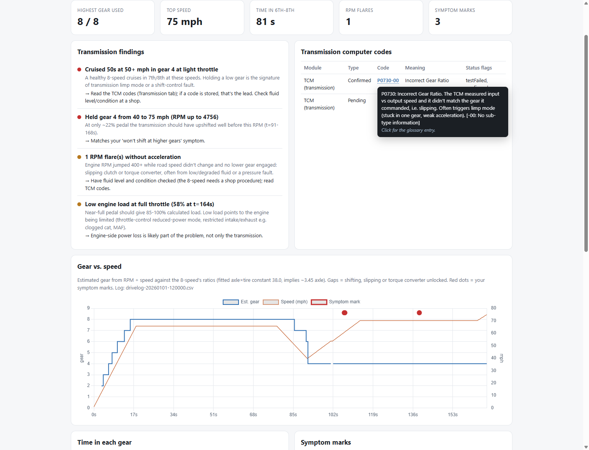

# Jeep Grand Cherokee DIY Diagnostics

Plug a USB OBD-II adapter into your Jeep, run one command on your laptop, and get a dashboard that shows:

- **Trouble codes** from the engine **and the transmission computer**, explained in plain English
- **Transmission behavior**: which gear you were actually in, whether it held a gear too long, slipped, or never reached the top gears
- **Health checks**: battery and charging voltage, fuel trims, coolant temperature, emissions readiness
- **Next steps**, ranked by priority

## 🛒 The one thing you need to buy

This tool talks to your Jeep through a USB adapter. It's built and tested around the **OBDLink EX**:

### [👉 Get the OBDLink EX USB adapter on Amazon](https://link.amazon/B0fmKRCjO)

[](https://link.amazon/B0fmKRCjO)

<sub>As an Amazon Associate I earn from qualifying purchases. It costs you nothing extra, and this tool stays free either way.</sub>



**It is read-only.** It never clears codes, never changes settings, and never writes anything to your vehicle. The worst it can do is fail to connect.

Built for the **2014 and newer Jeep Grand Cherokee (WK2) with the 8-speed automatic**. The code reading and health checks work on most 2008+ cars. The gear analysis assumes the 8-speed's gear ratios.

> **Status: early release.** The analysis is tested against simulated drives (see `tests/`). Testing on a real 2015 Grand Cherokee is in progress. Bug reports are welcome.

---

## What you need

| | |
|---|---|
| **A laptop** | Windows 10/11 (recommended). Mac and Linux work too, except the "press M to mark a symptom" key. |
| **A USB OBD-II adapter** | **[OBDLink EX](https://link.amazon/B0fmKRCjO)** (recommended; affiliate link). Other ELM327-compatible adapters may work, but cheap clones often drop the connection or can't reach the transmission computer. |
| **About 10 minutes** | For the one-time install. |

---

## Install (one time)

### Windows

1. Press the **Windows key**, type **PowerShell**, and open it.
2. Copy and paste this line, then press **Enter**. It installs `uv`, a small tool that manages Python for you:

   ```powershell
   powershell -ExecutionPolicy ByPass -c "irm https://astral.sh/uv/install.ps1 | iex"
   ```

3. **Close PowerShell and open it again** (so it picks up the new tool).
4. Paste this and press **Enter**:

   ```powershell
   uv tool install git+https://github.com/benjaminmbrown/jeep-grand-cherokee-diy-obd
   ```

5. Check it worked:

   ```powershell
   jeep-obd --help
   ```

   You should see a list of commands. If you see "not recognized", close and reopen PowerShell once more.

### Mac / Linux

```bash
curl -LsSf https://astral.sh/uv/install.sh | sh
# open a new terminal, then:
uv tool install git+https://github.com/benjaminmbrown/jeep-grand-cherokee-diy-obd
```

### Try it before you go to the car

```powershell
jeep-obd demo
```

This opens the dashboard in your browser using **made-up data** from a Jeep with a transmission problem, so you can see what you'll get. `jeep-obd demo --healthy` shows a healthy one.

---

## Use it

### 1. Scan the Jeep (2 minutes, parked)

1. Plug the adapter into the OBD port. It's under the dashboard, to the left of the steering column.
2. Plug the adapter's USB cable into the laptop.
3. Turn the ignition **ON** (engine running is best; it lets the charging and fuel checks run).
4. In PowerShell:

   ```powershell
   jeep-obd scan
   ```

The dashboard opens automatically when it's done. Everything is saved in a folder called **JeepOBD** in your user folder (run `jeep-obd where` to see the exact path).

### 2. Record a drive (to catch problems that only happen while driving)

**You need a passenger for this. Don't touch the laptop while you drive.**

1. Plug in as above, start the engine, and have your passenger run:

   ```powershell
   jeep-obd drive
   ```

2. Drive normally. Get to highway speed if you can and cruise for a minute.
3. Reproduce the problem. The moment it happens, the passenger presses **M** on the laptop. This drops a red marker on the charts at that exact moment.
4. If it's safe (an on-ramp), do one firm full-throttle acceleration for 3 to 5 seconds. This is how the tool checks for power loss.
5. Passenger presses **Ctrl+C** to stop. The dashboard opens with the drive analysis.

### 3. Read the dashboard

| Tab | What it shows |
|---|---|
| **Overview** | Overall status, key numbers, next steps, every health check, all trouble codes, scan history |
| **Transmission** | Codes from the transmission computer, gear-vs-speed chart, time in each gear, held-gear events, RPM flares (slipping), full-throttle power check, your symptom markers |
| **Drive log** | Charts of RPM, speed, temperatures, fuel trims, pedal and load, voltage, airflow |
| **Codes** | A searchable glossary. **Hover over any code anywhere on the dashboard** for a plain-English explanation; **click it** to jump to its full entry. |

The colored dots mean: 🔴 problem, 🟡 worth watching, 🟢 normal, 🔵 information.

---

## Commands

| Command | What it does |
|---|---|
| `jeep-obd scan` | Read codes and sensors, save, open the dashboard |
| `jeep-obd drive` | Scan, then record a drive until Ctrl+C. `--seconds 600` stops after 10 minutes. |
| `jeep-obd report` | Re-open the dashboard from saved scans (no car needed) |
| `jeep-obd demo` | Dashboard from simulated data. `--healthy` for a healthy vehicle. |
| `jeep-obd ports` | List the laptop's serial ports (to find the adapter) |
| `jeep-obd where` | Show where scans and the dashboard are saved |

Options for `scan` and `drive`: `--port COM7` picks the adapter's port manually; `--no-open` skips opening the browser. `--data-dir PATH` (before the command) saves somewhere else.

To update to the newest version: `uv tool upgrade jeep-obd`

---

## Troubleshooting

**"FAILED to connect"**
- Is the ignition on? The adapter needs the vehicle awake.
- Is the adapter pushed all the way into the port? Its light should be on.
- Run `jeep-obd ports`. Look for a line mentioning **USB Serial** or **OBDLink** and note its COM number, then run `jeep-obd scan --port COM7` (with your number).
- Ignore ports labeled **Bluetooth**. Those belong to the laptop, not the adapter.

**"TCM (transmission): NO RESPONSE"**
Try again with the engine running. If it still doesn't answer, please [open an issue](../../issues) with your model year and engine. Some years may use a different address.

**The charts are blank**
The charts need an internet connection the first time the dashboard opens (they load a charting library). The tables and checks work offline.

**A code says "manufacturer-specific" with no explanation**
Codes with a 1 or 3 in the second position (like P1xxx) are Chrysler/Jeep-specific and aren't in the public code list. Look them up by VIN in a factory service manual, with a dealer, or with AlfaOBD.

---

## Adding your own diagnosis notes (optional)

The Overview tab shows a written summary and next steps from a file called `notes.json` in your JeepOBD folder. You, a mechanic, or an AI assistant can write it:

```json
{
  "updated": "2026-11-14",
  "summary": "TCM has P0730 confirmed. Drive log shows it holding 4th at highway speed.",
  "next_steps": [
    {"priority": "high", "text": "Check transmission fluid level and condition."},
    {"priority": "medium", "text": "Ask the dealer about transmission software updates."}
  ]
}
```

Any code you type (like `P0730`) automatically gets a hover explanation. Run `jeep-obd report` to see the change.

---

## How the transmission analysis works

The adapter can't ask the transmission which gear it's in, but it can read engine RPM and road speed. On an 8-speed, each gear has a fixed ratio between them. The tool fits your axle and tire size from the data, then labels every moment with the gear that matches. From that it flags:

- **Cruising at highway speed in a low gear** (a healthy 8-speed cruises in 7th or 8th). This is the classic sign of *limp mode*.
- **Holding a gear while RPM climbs** at part throttle
- **RPM flares**: RPM jumps but speed doesn't, and no lower gear engaged. This is a sign of slipping.
- **RPM matching no gear under load**: slipping, or the torque converter unlocking
- **Weak full-throttle pulls**: low engine load or pulled timing suggests the engine is limiting power, not only the transmission

Gear numbers are estimates. The transmission computer's own codes (also read by this tool) are the authority.

---

## Safety and limits

- This tool **reads only**. It cannot clear codes or change settings. Use a dedicated tool (e.g. AlfaOBD) for that, carefully.
- It reads the **engine** and **transmission** computers. ABS, airbag and body module codes aren't read yet.
- It is **not a substitute for a mechanic**. It tells you where to look and what to ask.
- Never operate a laptop while driving.

## For developers

```bash
git clone https://github.com/benjaminmbrown/jeep-grand-cherokee-diy-obd
cd jeep-grand-cherokee-diy-obd
uv run --group dev pytest        # run the tests
uv run jeep-obd demo             # run from source
```

| Module | Role |
|---|---|
| `scanner.py` | Talks to the adapter: OBD-II modes 01/03/07/09 and UDS 0x19 (ReadDTCInformation) to the engine (0x7E0) and transmission (0x7E1) modules |
| `trans_analysis.py` | Gear estimation and transmission findings from a drive log |
| `report.py` | Builds the dashboard (single HTML file) |
| `glossary.py` | Plain-English code notes, failure-type suffixes, status flags |
| `demo.py` | Simulated healthy and faulty drives (used by `demo` and the tests) |
| `cli.py` | The `jeep-obd` command |

## License and credits

GPL-2.0, because it builds on [python-OBD](https://github.com/brendan-w/python-OBD) (GPL-2.0), which handles the adapter communication and provides the generic code definitions. Charts by [Chart.js](https://www.chartjs.org/).

Not affiliated with, endorsed by, or connected to Jeep, Stellantis, or FCA. "Jeep" and "Grand Cherokee" are trademarks of their owners, used here only to describe compatibility.
